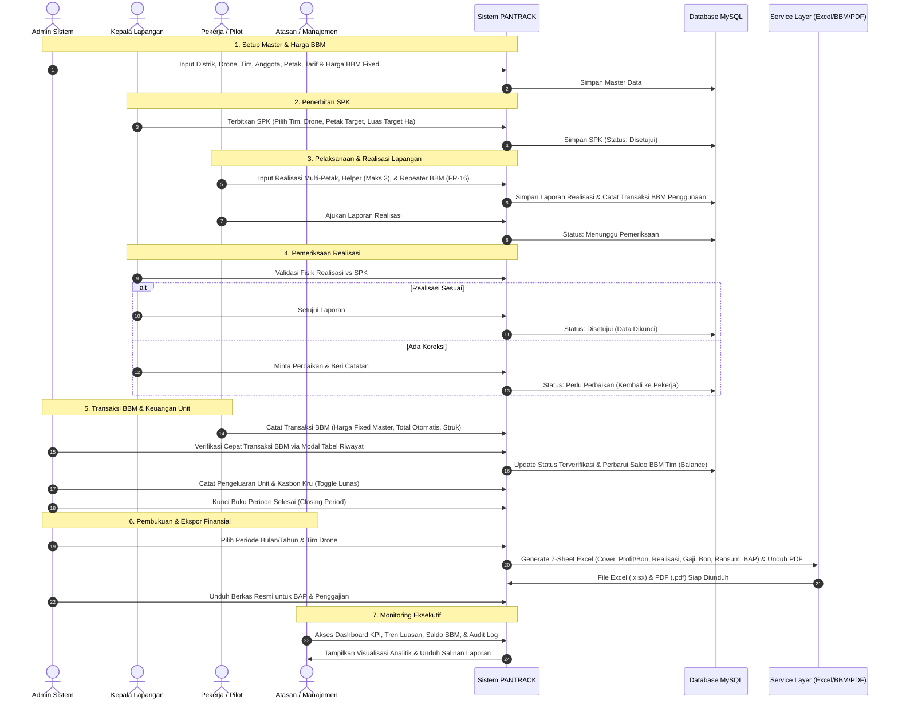

# PANTRACK — Panlibata Tracking System

[](file:///d:/Aisyah/PENELITIAN/pantrack/pantrack)
[](https://laravel.com)
[](https://php.net)
[](https://tailwindcss.com)
[](https://mysql.com)
[-success.svg)](file:///d:/Aisyah/PENELITIAN/pantrack/pantrack)
[](#lisensi)

> **Sistem Manajemen Monitoring Pekerjaan Drone Agrikultur & Akuntansi Operasional Berbasis Web**  
> **Perusahaan:** PT. Panlibata Andalas Bertuah  
> **Versi Rilis:** 1.2.0 (Stable & Production Ready)  
> **Lisensi:** Proprietary / Internal PT. Panlibata Andalas Bertuah  

---

## 1. Judul & Deskripsi Proyek

### 1.1 Ringkasan Proyek
**PANTRACK (Panlibata Tracking System)** adalah aplikasi manajemen operasional berbasis web terpadu tingkat enterprise (*enterprise-grade operational tracking & unit accounting system*) yang dirancang khusus untuk memonitor, mengaudit, memeriksa, mengesahkan, dan merekapitulasi seluruh siklus kerja unit drone agrikultur (penyemprotan pestisida/pupuk cair dan penaburan pupuk butiran) di lingkungan perkebunan PT. Panlibata Andalas Bertuah.

PANTRACK mengintegrasikan data operasional lapangan secara *end-to-end*:
- **Penerbitan Surat Perintah Kerja (SPK)** terstruktur multi-petak dengan validasi distrik dan penguncian status otomatis.
- **Pelaporan Realisasi Lapangan Dinamis**: Formulir multi-petak, alokasi hingga 3 personil helper lokal dengan premi hektar, dan repeater multi-input konsumsi BBM penerbangan (FR-16).
- **Pembukuan Logistik & Saldo BBM Tim**: Saldo terisolasi per tim, otomatisasi harga satuan fixed dari master data jenis BBM, kalkulasi total biaya real-time, simbol indikator mutasi stok (+, -, ±), penguncian otomatis keperluan penambahan stok (`stok_masuk`), serta modal verifikasi cepat Admin langsung dari tabel riwayat.
- **Administrasi Keuangan Operasional & Kasbon Kru**: Pencatatan pengeluaran operasional unit, toggle pelunasan kasbon, dan sistem penguncian periode pembukuan (*Closing Period*) yang fleksibel.
- **Generator Dokumen Finansial Ganda**: Ekspor **Buku Kerja 7-Sheet Microsoft Excel** (`.xlsx`) berstandar akuntansi resmi perkebunan dan dokumen cetak **Berita Acara Pembayaran (BAP) PDF** (`.pdf`).

> [!NOTE]
> PANTRACK berfokus penuh pada **manajemen operasional lapangan, verifikasi administratif, akuntansi unit kerja, dan kepatuhan audit**. Sistem ini bukan perangkat lunak kendali terbang langsung (*Ground Control Station* / GCS).

---

### 1.2 Masalah yang Diselesaikan
Sebelum implementasi sistem PANTRACK, alur operasional dan pelaporan lapangan menghadapi sejumlah kendala kritis:
1. **Laporan Lapangan Terfragmentasi**: Pelaporan kerja harian dikirimkan melalui grup obrolan instan secara sporadis, menyulitkan pelacakan histori pekerjaan dan foto bukti lapangan.
2. **Redundansi & Kesalahan Input Manual**: Staf administrasi harus menyalin ulang pesan laporan ke dalam lembar kerja Excel terpisah, memicu risiko tinggi *human error* dan data selisih.
3. **Ketidaksesuaian Rencana vs Realisasi**: Sulit memastikan apakah luasan hektar (Ha) aktual yang disemprot pilot sesuai dengan target SPK yang diterbitkan Kepala Lapangan.
4. **Kebocoran & Ketidakjelasan Saldo BBM**: Transaksi bahan bakar (solar/pertalite) kerap tidak tercatat harga satuan, nomor nota fisik, maupun keperluan operasionalnya. Saldo tidak terisolasi antar unit drone.
5. **Keterlambatan Rekapitulasi Gaji & Bon**: Perhitungan insentif pilot/helper, potongan kasbon personil, penggantian bon solar/sparepart, dan pembagian hasil (Net Revenue 80%, ADM 5%, Investor Modal 15%) memerlukan waktu berhari-hari setiap akhir bulan.
6. **Ketiadaan Jejak Audit (Audit Trail)**: Perubahan data, koreksi angka luas, maupun pembatalan transaksi tidak terdokumentasi mengenai siapa pelaksananya dan kapan dilakukan.

---

## 2. Arsitektur & Alur Sistem (Workflow)

### 2.1 Arsitektur Sistem
PANTRACK dibangun menggunakan pola arsitektur **Model-View-Controller (MVC)** yang diperkaya dengan **Service Layer Pattern** untuk menangani kalkulasi bisnis kompleks:
- **Presentation Layer (View)**: Antarmuka modern dan responsif berbasis Blade Templates, Tailwind CSS v4, Bootstrap Icons, dan visualisasi diagram interaktif menggunakan Chart.js.
- **Application / Controller Layer**: Mengatur navigasi, validasi form request, otentikasi sesi ganda, dan otorisasi *Role-Based Access Control* (RBAC) via middleware Laravel.
- **Service Layer**:
  - `EksporExcelService`: Menghasilkan dokumen Excel 7-Sheet (*Cover, Rekap Profit & Bon, Lampiran Realisasi, Slip Gaji Tim, Rincian Bon Unit, Ransum/Kantin, BAP*) sesuai formula resmi perkebunan.
  - `BbmService`: Mengelola pembukuan saldo bahan bakar resmi dan tersedia, mutasi debit/kredit, verifikasi invoice, dan validasi transaksi BBM terisolasi per tim.
  - `DashboardService`: Agregasi metrik KPI, tren luasan bulanan, dan ringkasan persetujuan tertunda secara efisien.
  - `RiwayatAktivitasService`: Pencatatan log aktivitas dan jejak audit otomatis pada setiap aksi krusial sistem.
- **Data Persistence Layer (Model & Database)**: MySQL 8.0+ dengan relasi *foreign-key* terindeks dan proteksi integritas transaksi database (`DB::transaction`).

---

### 2.2 Alur Kerja Bertahap (Step-by-Step Workflow)

```
[1. SETUP MASTER] ──> [2. PENERBITAN SPK] ──> [3. REALISASI & BBM] ──> [4. VERIFIKASI DOKUMEN]
     (Admin)             (Kepala Lapangan)        (Pekerja Lapangan)      (Kepala Lapangan & Admin)
                                                                                   │
[7. MONITORING ATASAN] <── [6. EKSPOR EXCEL & PDF] <── [5. KASBON & CLOSING] <─────┘
   (Manajemen/Owner)           (Admin/Atasan)                  (Admin)
```

1. **Tahap 1 — Setup Master Data (Admin)**:
   - Admin mengonfigurasi data master: Distrik perkebunan, Unit Drone, Tim Lapangan & Anggota (Pilot & Helper beserta tarif premi per Ha dan uang makan), Petak kebun (Ha), Jenis Pekerjaan (Spraying/Spreading), Jenis BBM beserta harga fixed per liter, dan Tarif Dasar Pekerjaan per Ha.
2. **Tahap 2 — Penerbitan SPK (Kepala Lapangan)**:
   - Kepala Lapangan membuat Surat Perintah Kerja (SPK) baru yang menentukan nomor SPK, tim pelaksana, unit drone, petak-petak kebun yang ditugaskan, dan total luas target (Ha). SPK yang disetujui siap diambil oleh pekerja lapangan.
3. **Tahap 3 — Pelaksanaan & Pelaporan Realisasi (Pekerja Lapangan / Pilot)**:
   - Pilot dan tim menyelesaikan misi penerbangan di lapangan.
   - Pekerja menginput **Laporan Realisasi** harian: memilih petak terdaftar dari SPK, mengisi luas realisasi aktual (Ha), kondisi cuaca, kendala lapangan, menginput nama personil helper lapangan (dinamis hingga 3 orang), mencatat konsumsi BBM operasional via form repeater (FR-16), serta melampirkan foto dokumentasi kerja.
   - Pekerja mengajukan laporan (`Draf` &rarr; `Menunggu Pemeriksaan`).
4. **Tahap 4 — Verifikasi & Pengesahan Lapangan (Kepala Lapangan)**:
   - Kepala Lapangan memverifikasi kesesuaian fisik antara data SPK dan input realisasi.
   - Pilihan keputusan: **Setujui (`Disetujui`)** untuk mengunci data kerja, atau **Minta Revisi (`Perlu Perbaikan`)** disertai catatan koreksi.
5. **Tahap 5 — Manajemen BBM & Keuangan Unit (Pekerja & Admin)**:
   - **Bahan Bakar (BBM)**: Pekerja menginput transaksi BBM. Harga satuan per liter terisi otomatis dari master data, dan total biaya dihitung real-time. Admin memverifikasi transaksi melalui modal dialog cepat pada tabel riwayat; persetujuan langsung menambah/mengurangi saldo stok tim secara balance.
   - **Keuangan & Bon Operasional**: Admin mencatat biaya operasional unit (servis, suku cadang, sewa mobil, ransum) dan kasbon personil. Kasbon dilengkapi tombol instan toggle status lunas.
   - **Penutupan Periode (Closing Period)**: Admin menutup periode buku yang telah lewat agar penambahan kasbon baru dicegah, dengan tetap menjaga akurasi akumulasi kasbon berjalan.
6. **Tahap 6 — Rekapitulasi & Ekspor Laporan Resmi (Admin & Atasan)**:
   - Admin/Atasan membuka menu Ekspor Laporan, memilih periode bulan/tahun dan tim drone terkait.
   - Sistem menghasilkan file **7-Sheet Excel (`.xlsx`)** dan dokumen cetak **PDF (`.pdf`)** secara otomatis:
     - Pendapatan kotor = Total Luas Realisasi &times; Tarif Per Ha.
     - Pembagian hasil: **80% Net Realisasi Unit**, **5% Biaya ADM Kantor**, **15% Bagi Hasil Investor Modal**.
     - Slip gaji kru (gaji pokok, premi pilot, premi helper per Ha, uang makan harian, dikurangi kasbon).
     - Rincian bon unit dan tabel saldo hutang bergulir (*Rolling Debt Table*).
7. **Tahap 7 — Monitoring & Evaluasi Eksekutif (Atasan)**:
   - Atasan mengakses dashboard analitik untuk melihat ringkasan KPI, tren produktivitas bulanan, status ketersediaan saldo BBM tim, dan jejak audit aktivitas sistem.

---

### 2.3 Diagram Alur Sistem (Mermaid Sequence)



---

## 3. Fitur Utama

### 3.1 Otentikasi, Landing Page & Hak Akses Berbasis Peran (RBAC)
- **Landing Page Interaktif**: Halaman selamat datang yang profesional dan informatif sebelum pengguna diarahkan ke formulir login akun.
- **Role-Based Access Control (RBAC)** dengan 4 peran berwewenang tegas:
  - `admin`: Pengelola master data penuh, verifikator mutasi BBM, administrator pengeluaran unit/kasbon, penutup periode buku, dan pembuat laporan ekspor.
  - `kepala_lapangan`: Pembuat SPK lapangan, pengawas operasional, pemeriksa realisasi, dan penentu status tuntas SPK.
  - `pekerja_lapangan`: Pelaksana tugas lapangan yang menginput realisasi harian multi-petak, personil helper, dan konsumsi BBM operasional.
  - `atasan`: Akses eksekutif ke dashboard analitik, pemantauan SPK, audit trail, serta pengunduhan laporan akhir.
- **Middleware Keamanan Berlapis**: `auth`, `aktif` (mencegah akses akun nonaktif), dan `peran` (memvalidasi hak akses rute).
- Manajemen Profil mandiri dan fasilitas ganti kata sandi berstandar Bcrypt (12 rounds).

### 3.2 Manajemen Master Data Operasional Terpusat
- **Distrik**: Pengelompokan wilayah kebun kelapa sawit / tanaman industri.
- **Drone**: Registrasi armada drone (nomor registrasi, tipe, kapasitas tangki, batas jam terbang, status servis/perawatan).
- **Tim & Anggota**: Penugasan pilot & helper lapangan, konfigurasi tarif gaji pokok, premi pilot per Ha, premi helper per Ha, dan uang makan harian.
- **Petak Kebun**: Kode petak kebun, distrik, dan luas baku standar (Ha).
- **Jenis Pekerjaan**: Kategori aplikasi kerja (*Spraying Pupuk/Pestisida*, *Spreading Butiran*).
- **Jenis BBM**: Master bahan bakar (*Pertamax, Pertalite, Solar*) dengan kolom **`harga_per_liter` fixed** yang ditentukan oleh Admin.
- **Tarif Pekerjaan**: Konfigurasi tarif jasa per Ha aktif berdasarkan jenis pekerjaan dan distrik.

### 3.3 Siklus Surat Perintah Kerja (SPK) Terstruktur
- Penerbitan SPK sebelum tim berangkat ke lapangan, mencantumkan target petak dan target luas (Ha).
- Sinkronisasi ketat: Petak yang ditugaskan wajib berada dalam distrik yang sama dengan SPK.
- Fitur penandaan SPK selesai (`selesai`): SPK yang telah tuntas otomatis tidak lagi muncul pada daftar pilihan laporan realisasi baru.

### 3.4 Pelaporan Realisasi Multi-Petak & Multi-Helper Dinamis
- **Formulir Realisasi Multi-Petak**: Memungkinkan pekerja mencatat banyak petak kerja dalam satu hari menggunakan baris tabel dinamis.
- **Input Dinamis Helper Lapangan (Maksimal 3 Orang)**: Mendukung penambahan hingga 3 helper warga lokal dengan nomor urut (`#1`, `#2`, `#3`), tombol hapus dinamis, dan kalkulasi premi per Ha otomatis.
- **Integrasi Pilihan Petak SPK**: Memuat daftar petak dan target luas langsung dari SPK dengan tombol *Muat Petak dari SPK*.
- **Upload Dokumentasi Fisik**: Pengunggahan foto pekerjaan dari kamera atau galeri untuk verifikasi Kepala Lapangan.

### 3.5 Monitoring & Pembukuan Transaksi BBM (FR-16 s/d FR-21)
- **Harga Satuan Fixed oleh Admin**: Field harga per liter otomatis terisi dari master data Jenis BBM dan berstatus `readonly` bagi pekerja untuk mencegah salah input atau mark-up harga.
- **Kalkulasi Biaya Real-Time**: Field *Total Biaya Pembelian (Rp)* dihitung otomatis secara instan (`Jumlah Liter × Harga Satuan per Liter`) dan dikunci `readonly`.
- **Indikator Simbol Mutasi Stok**: Dropdown pilihan dan tabel riwayat transaksi dilengkapi simbol mutasi saldo:
  - `Stok awal (+)` &rarr; Menambah saldo stok tim.
  - `Pengajuan (Draft)` &rarr; Pengajuan kebutuhan BBM (belum memengaruhi saldo).
  - `Penerimaan (+)` &rarr; Menambah saldo stok tim setelah verifikasi.
  - `Penggunaan (-)` &rarr; Memotong saldo stok tim.
  - `Penyesuaian (±)` &rarr; Menyesuaikan saldo fisik di lapangan.
- **Otomatisasi Field Keperluan**: Saat transaksi penambahan stok (+), field keperluan terkunci otomatis dengan opsi `Stok BBM Masuk`. Saat transaksi penggunaan (-), field mewajibkan pemilihan keperluan operasional (*Operasional Drone*, *Genset Lapangan*, *Mobil Tim*, dll.).
- **Tampilan Badge Status & Verifikasi Admin Cepat**:
  - Kolom jenis transaksi dan status verifikasi menampilkan badge teks keterangan lengkap (`Terverifikasi`, `Menunggu Verifikasi`, `Perlu Perbaikan`, `Ditolak`).
  - Tombol **Verifikasi** pada kolom aksi membuka modal dialog interaktif (`#dialog-verifikasi-bbm`) bagi Admin untuk menyetujui, meminta perbaikan, atau menolak transaksi secara langsung dari tabel.
  - Persetujuan transaksi langsung memperbarui saldo stok resmi tim secara balance.
- **Multi-Input Repeater Konsumsi BBM Penerbangan (FR-16)**: Pada formulir realisasi, tersedia form dinamis dengan tombol *+ Tambah Rincian Penggunaan BBM* untuk mencatat beberapa rincian konsumsi (Drone, Genset, Kendaraan) sekaligus dalam satu laporan.

### 3.6 Administrasi Keuangan Unit & Kontrol Tutup Periode (Closing)
- **Pencatatan Biaya Operasional**: Biaya solar genset, oli, servis drone, sewa mobil, ransum kantin, dan bon pribadi pemilik unit.
- **Manajemen Kasbon Kru**: Pengajuan kasbon pilot/helper dengan tombol aksi cepat **Toggle Status Lunas** (`Lunas` / `Belum Lunas`).
- **Fitur Tutup Periode (Closing Period)**: Admin dapat menutup periode pembukuan yang telah berlalu. Pada periode tertutup, penambahan kasbon baru dicegah, namun saldo kasbon lama tetap terhitung secara akurat pada neraca keuangan. Admin dapat membuka kembali (*Reopen*) jika diperlukan penyesuaian khusus.

### 3.7 Generator Laporan Finansial 7-Sheet Excel & Ekspor PDF
- Menggunakan modul `EksporExcelService` berbasis `PhpSpreadsheet` untuk menghasilkan file workbook `.xlsx` yang terdiri dari 7 lembar kerja resmi:
  1. **Sheet 1: Cover / Rekapitulasi Pembayaran**: Ringkasan eksekutif total luas kerja (Ha), pendapatan kotor, potongan operasional, dan nilai transfer bersih.
  2. **Sheet 2: Rekap Profit & Bon**: Pembagian hasil pendapatan kotor sesuai skema bisnis resmi: **80% Net Realisasi**, **5% Biaya ADM**, **15% Investor Modal**, serta tabel saldo hutang bergulir (*Rolling Debt Table*) unit.
  3. **Sheet 3: Lampiran Realisasi**: Ledger rinci 14 kolom menyajikan tanggal kerja, nomor SPK, tim, petak, jenis pekerjaan, luasan (Ha), tarif dasar, dan insentif mapping/entertainment.
  4. **Sheet 4: Slip Gaji Tim**: Perhitungan gaji pilot & helper (gaji pokok, premi luas per Ha, uang makan harian berbasis hari kerja riil, dikurangi kasbon).
  5. **Sheet 5: Rincian Operasional & Bon**: Daftar rincian seluruh bon operasional unit, servis bengkel, dan suku cadang.
  6. **Sheet 6: Ransum & Kantin**: Rekapitulasi biaya konsumsi dan perbekalan per hari kerja.
  7. **Sheet 7: BAP (Berita Acara Pembayaran)**: Dokumen formal serah terima hasil pekerjaan lengkap dengan kolom pengesahan dan tanda tangan.
- **Ekspor Dokumen PDF Resmi**: Tersedia tombol *Unduh PDF Resmi* di samping ekspor Excel untuk mencetak dokumen Berita Acara dan rekapitulasi siap tanda tangan.

### 3.8 Dashboard Eksekutif & Audit Trail (Riwayat Aktivitas)
- **Dashboard Interaktif**: Statistik luasan kerja bulan berjalan, jumlah SPK aktif, saldo stok BBM per tim, dan visualisasi tren produktivitas berbasis Chart.js.
- **Riwayat Aktivitas**: Setiap penambahan data, perubahan status, pengesahan, penolakan, dan ekspor laporan dicatat lengkap dengan stempel waktu (*timestamp*) dan identitas pengguna.

---

## 4. Teknologi yang Digunakan (Tech Stack)

### 4.1 Backend
- **Bahasa Pemrograman**: PHP 8.2 / 8.3
- **Framework**: Laravel 12.x (Modern Architecture)
- **Otentikasi & Keamanan**: Session-Based Authentication, Password Hash via Bcrypt (12 rounds), CSRF Protection, Form Request Validation, Policy & Middleware Access Control.
- **Manipulasi Spreadsheet**: `phpoffice/phpspreadsheet` v5.10+ (Kalkulasi formula akuntansi, borders, number formatting mata uang, autofit columns).
- **Generator Dokumen PDF**: `barryvdh/laravel-dompdf` v3.1+ (Render dokumen cetak resmi BAP dari template Blade).

### 4.2 Database
- **DBMS**: MySQL 8.0+ / MariaDB 10.4+
- **Storage Engine**: InnoDB dengan strict foreign key constraint & cascading logic.
- **Manajemen Skema**: Laravel Migrations & Database Seeders.

### 4.3 Frontend
- **Templating Engine**: Laravel Blade Engine
- **Styling**: Tailwind CSS v4 & PANTRACK Custom Design System.
- **Ikonografi**: Bootstrap Icons (SVG & font icon).
- **Grafik & Visualisasi**: Chart.js v4.x (Diagram batang dan grafik garis tren kerja bulanan).
- **JavaScript**: Vanilla ES6+ untuk dynamic repeater table, real-time cost calculation, dan modal dialogs.
- **Asset Bundler**: Vite 7.x via `laravel-vite-plugin`.

### 4.4 Development & Testing Tools
- **Unit & Feature Testing**: PHPUnit 11.5+, Mockery (31 pengujian fitur lulus).
- **CLI & Diagnostics**: Laravel Artisan, Laravel Tinker, Laravel Pail.
- **Package Manager**: Composer 2.x & NPM.

---

## 5. Struktur Direktori Proyek

Tata letak direktori dan file kunci dalam aplikasi PANTRACK:

```plaintext
pantrack/
├── app/
│   ├── Http/
│   │   ├── Controllers/
│   │   │   ├── AuthController.php              # Otentikasi login & logout sesi
│   │   │   ├── BbmController.php               # Manajemen transaksi BBM, mutasi & verifikasi
│   │   │   ├── DashboardController.php         # Handler dashboard & KPI analitik
│   │   │   ├── EksporLaporanController.php     # Controller unduh Excel 7-sheet & PDF resmi
│   │   │   ├── KeuanganUnitController.php      # Controller pengeluaran unit, kasbon, & closing
│   │   │   ├── LandingController.php           # Landing page publik sebelum login
│   │   │   ├── LaporanRealisasiController.php  # CRUD realisasi multi-petak, helper, & repeater BBM
│   │   │   ├── ProfilController.php            # Profil pengguna & ubah kata sandi
│   │   │   ├── RiwayatAktivitasController.php  # Audit log aktivitas sistem
│   │   │   ├── SpkController.php               # Pembuatan, pengelolaan, & closing SPK
│   │   │   └── Master/                         # Controller Master Data (Admin)
│   │   │       ├── AnggotaTimController.php
│   │   │       ├── DistrikController.php
│   │   │       ├── DroneController.php
│   │   │       ├── JenisBbmController.php      # Master BBM beserta harga tetap per liter
│   │   │       ├── JenisPekerjaanController.php
│   │   │       ├── PenggunaController.php
│   │   │       ├── PetakController.php
│   │   │       ├── TarifPekerjaanController.php
│   │   │       └── TimController.php
│   │   └── Middleware/
│   │       ├── BatasiPeran.php                 # Middleware otorisasi RBAC (peran)
│   │       └── PastikanPenggunaAktif.php       # Middleware validasi akun aktif
│   ├── Models/                                 # Eloquent Models (Spk, Realisasi, BBM, Keuangan, dll.)
│   ├── Providers/                              # Service Providers Laravel
│   └── Services/                               # Business Logic & Complex Services
│       ├── BbmService.php                      # Kalkulasi saldo resmi & saldo tersedia tim
│       ├── DashboardService.php                # Agregasi data statistik & grafik
│       ├── EksporExcelService.php              # Generator Workbook 7-Sheet Excel resmi
│       └── RiwayatAktivitasService.php         # Logging jejak audit aktivitas sistem
├── bootstrap/
│   └── app.php                                 # Konfigurasi routing & middleware modern
├── config/                                     # Konfigurasi aplikasi (app, database, filesystems, auth)
├── database/
│   ├── factories/                              # Model factories untuk testing
│   ├── migrations/                             # Skema migrasi database
│   └── seeders/
│       └── DatabaseSeeder.php                  # Data awal peran, akun pengguna, & master operasional
├── public/                                     # Web server root & aset publik terkompilasi
├── resources/
│   ├── css/                                    # Sumber CSS aplikasi & Tailwind CSS v4
│   ├── js/                                     # Script JavaScript aplikasi
│   └── views/                                  # Tampilan antarmuka Blade Templates
│       ├── bbm/                                # Halaman monitoring, form, & dialog verifikasi BBM
│       ├── components/                         # Komponen Blade reusable (lencana, field, dll.)
│       ├── dashboard/                          # Halaman dashboard sesuai peran
│       ├── ekspor/                             # Halaman filter & unduh laporan Excel/PDF
│       ├── keuangan/                           # Halaman pengeluaran unit, kasbon, & dialog closing
│       ├── landing/                            # Landing page interaktif publik
│       ├── layouts/                            # Layout utama navigasi & sidebar
│       ├── master/                             # Tampilan formulir & tabel data master
│       ├── realisasi/                          # Formulir realisasi multi-petak, helper, & repeater BBM
│       ├── riwayat/                            # Tampilan log audit trail
│       └── spk/                                # Halaman pengelolaan SPK lapangan
├── routes/
│   ├── console.php                             # Perintah CLI artisan
│   └── web.php                                 # Definisi seluruh rute aplikasi & proteksi middleware
├── storage/                                    # Berkas unggahan struk BBM, foto lapangan, & log
├── tests/
│   ├── Feature/                                # Feature tests (BbmDanRealisasi, Keuangan, Core)
│   └── Unit/                                   # Unit tests logika aplikasi
├── .env.example                                # Contoh konfigurasi environment
├── composer.json                               # Dependensi pustaka PHP
├── package.json                                # Dependensi aset front-end
├── phpunit.xml                                 # Konfigurasi otomatisasi pengujian
└── README.md                                   # Dokumentasi resmi proyek
```

---

## 6. Panduan Instalasi & Konfigurasi

### 6.1 Prasyarat Sistem (Prerequisites)
Pastikan perangkat lunak berikut telah terpasang pada komputer pengembang atau server:
- **PHP**: Versi `>= 8.2` (ekstensi aktif: `pdo_mysql`, `mbstring`, `openssl`, `fileinfo`, `zip`, `gd` atau `imagick`, `xml`, `bcmath`).
- **Composer**: Versi `>= 2.5` ([Download Composer](https://getcomposer.org))
- **Node.js & NPM**: Node.js `>= 18.x` dan NPM `>= 9.x` ([Download Node.js](https://nodejs.org))
- **Database Server**: MySQL `>= 8.0` atau MariaDB `>= 10.4`
- **Git**: Versi `>= 2.30`

---

### 6.2 Langkah Instalasi

#### 1. Salin / Buka Proyek
Masuk ke direktori proyek melalui terminal:
```bash
git clone https://github.com/panlibata/pantrack.git
cd pantrack/pantrack
```

#### 2. Pasang Dependensi Backend (Composer)
```bash
composer install
```

#### 3. Pasang Dependensi Frontend (NPM)
```bash
npm install
```

#### 4. Buat File Konfigurasi Environment (`.env`)
Salin file `.env.example` menjadi `.env`:
```bash
# Untuk Linux / macOS / Git Bash
cp .env.example .env

# Untuk Windows PowerShell / CMD
copy .env.example .env
```

#### 5. Buat Database MySQL
Buat database baru bernama `pantrack`:
```sql
CREATE DATABASE pantrack CHARACTER SET utf8mb4 COLLATE utf8mb4_unicode_ci;
```

#### 6. Konfigurasi Variabel Database pada `.env`
Buka file `.env` dan sesuaikan koneksi database Anda:
```dotenv
APP_NAME=PANTRACK
APP_ENV=local
APP_DEBUG=true
APP_URL=http://localhost:8000

APP_TIMEZONE=Asia/Jakarta
APP_LOCALE=id

DB_CONNECTION=mysql
DB_HOST=127.0.0.1
DB_PORT=3306
DB_DATABASE=pantrack
DB_USERNAME=root
DB_PASSWORD=
```

#### 7. Generate Application Key
```bash
php artisan key:generate
```

#### 8. Jalankan Migrasi & Database Seeder
Eksekusi migrasi skema tabel dan muat seluruh data awal (akun peran, jenis pekerjaan, jenis BBM beserta harga satuan, distrik, drone, dan master dasar):
```bash
php artisan migrate --seed
```

#### 9. Hubungkan Direktori Storage Publik (Symlink)
Hubungkan folder berkas lampiran (foto pekerjaan, bukti struk BBM) ke direktori publik:
```bash
php artisan storage:link
```

#### 10. Kompilasi Aset Frontend
```bash
# Mode pengembangan
npm run dev

# Atau mode produksi
npm run build
```

#### 11. Jalankan Server Aplikasi
```bash
php artisan serve
```
Aplikasi siap diakses melalui peramban web pada alamat: **`http://localhost:8000`** atau **`http://127.0.0.1:8000`**.

> [!TIP]
> Anda juga dapat menjalankan server Laravel, antrean worker, logs, dan Vite secara bersamaan dalam satu baris perintah:
> ```bash
> composer run dev
> ```

---

### 6.3 Kredensial Akun Default (Bawaan Seeder)

Semua akun default menggunakan kata sandi standar: **`password`**

| Peran (Role) | Username | Password | Lingkup Tugas & Tanggung Jawab Utama |
|---|---|---|---|
| **Admin** | `admin` | `password` | Kelola master data, tetapkan harga BBM, verifikasi transaksi BBM, keuangan unit, kasbon, closing periode, & ekspor 7-Sheet |
| **Kepala Lapangan** | `kepala` | `password` | Menerbitkan SPK penugasan, memvalidasi & menyetujui laporan realisasi kerja, menandai SPK selesai |
| **Pekerja Lapangan** | `pekerja` | `password` | Mengerjakan SPK, input realisasi multi-petak, alokasi helper, dan catat repeater konsumsi BBM (FR-16) |
| **Atasan** | `atasan` | `password` | Akses monitoring dashboard eksekutif, grafik tren luasan, audit trail, dan unduh laporan resmi |

> [!WARNING]
> Sebelum melakukan deployment ke lingkungan produksi (*production*), pastikan untuk mengganti seluruh kata sandi bawaan, mengatur `APP_ENV=production`, dan mematikan mode debug (`APP_DEBUG=false`).

---

## 7. Dokumentasi Endpoint Rute Aplikasi

Aplikasi PANTRACK menerapkan arsitektur *Server-Side Rendered (SSR)* berbasis web dengan proteksi middleware session Laravel. Berikut adalah referensi rute penting dan fungsionalitasnya:

### 7.1 Landing Page, Otentikasi & Akun
| Method | URI | Nama Rute | Middleware | Keterangan |
|---|---|---|---|---|
| `GET` | `/` | `landing` | — | Landing page publik interaktif |
| `GET` | `/login` | `login` | `guest` | Formulir login akun |
| `POST` | `/login` | `login.proses` | `guest` | Validasi & pembuatan sesi masuk |
| `POST` | `/logout` | `logout` | `auth` | Menghancurkan sesi pengguna |
| `GET` | `/profil` | `profil.index` | `auth, aktif` | Halaman profil pengguna |
| `PUT` | `/profil` | `profil.update` | `auth, aktif` | Memperbarui nama dan nomor telepon |
| `PUT` | `/profil/kata-sandi`| `profil.password` | `auth, aktif` | Memperbarui kata sandi akun |

---

### 7.2 Dashboard & Riwayat Audit
| Method | URI | Nama Rute | Middleware | Keterangan |
|---|---|---|---|---|
| `GET` | `/dashboard` | `dashboard` | `auth, aktif` | Dashboard KPI dan grafik operasional sesuai peran |
| `GET` | `/riwayat-aktivitas` | `riwayat.index` | `auth, aktif` | Daftar rekaman audit jejak aktivitas sistem |

---

### 7.3 Operasional Surat Perintah Kerja (SPK)
| Method | URI | Nama Rute | Akses Peran | Keterangan |
|---|---|---|---|---|
| `GET` | `/spk` | `spk.index` | `pekerja, kepala, atasan` | Daftar tabel seluruh SPK |
| `GET` | `/spk/create` | `spk.create` | `kepala_lapangan` | Form penerbitan SPK baru |
| `POST` | `/spk` | `spk.store` | `kepala_lapangan` | Simpan SPK & rincian petak target |
| `GET` | `/spk/{spk}` | `spk.show` | `pekerja, kepala, atasan` | Detail rincian penugasan SPK |
| `GET` | `/spk/{spk}/edit` | `spk.edit` | `kepala_lapangan` | Form koreksi data SPK |
| `PUT` | `/spk/{spk}` | `spk.update` | `kepala_lapangan` | Perbarui data SPK |
| `POST` | `/spk/{spk}/selesai` | `spk.selesai` | `kepala_lapangan` | Menandai SPK telah tuntas dikerjakan |
| `POST` | `/spk/{spk}/verifikasi`| `spk.verifikasi`| `kepala_lapangan` | Verifikasi status SPK |
| `DELETE`| `/spk/{spk}` | `spk.destroy` | `kepala_lapangan` | Batalkan / hapus SPK draf |
| `GET` | `/spk/{spk}/berkas` | `spk.berkas` | `pekerja, kepala, atasan` | Unduh berkas lampiran SPK |

---

### 7.4 Laporan Realisasi Multi-Petak Lapangan & Helper
| Method | URI | Nama Rute | Akses Peran | Keterangan |
|---|---|---|---|---|
| `GET` | `/realisasi` | `realisasi.index` | `pekerja, kepala, atasan` | Daftar laporan realisasi kerja |
| `GET` | `/realisasi/create` | `realisasi.create`| `pekerja_lapangan` | Form input realisasi multi-petak, helper (maks 3), & repeater BBM |
| `POST` | `/realisasi` | `realisasi.store` | `pekerja_lapangan` | Simpan data realisasi, helper, repeater BBM, & foto bukti |
| `GET` | `/realisasi/{id}` | `realisasi.show` | `pekerja, kepala, atasan` | Rincian petak, cuaca, helper, tabel konsumsi BBM, & foto |
| `GET` | `/realisasi/{id}/edit`| `realisasi.edit` | `pekerja_lapangan` | Form ubah draf/revisi laporan realisasi |
| `PUT` | `/realisasi/{id}` | `realisasi.update` | `pekerja_lapangan` | Perbarui laporan realisasi & repeater BBM |
| `DELETE`| `/realisasi/{id}` | `realisasi.destroy`| `pekerja_lapangan` | Hapus laporan realisasi berstatus draf |
| `POST` | `/realisasi/{id}/ajukan`| `realisasi.ajukan`| `pekerja_lapangan` | Mengajukan laporan untuk verifikasi |
| `POST` | `/realisasi/{id}/periksa`| `realisasi.periksa`| `kepala_lapangan` | Setujui (`Disetujui`) atau Tolak (`Perlu Perbaikan`) |
| `GET` | `/realisasi/lampiran/{id}`| `realisasi.lampiran`| `pekerja, kepala, atasan` | Unduh lampiran foto bukti kerja |

---

### 7.5 Monitoring & Pembukuan Transaksi BBM
| Method | URI | Nama Rute | Akses Peran | Keterangan |
|---|---|---|---|---|
| `GET` | `/bbm` | `bbm.index` | `admin, kepala, pekerja, atasan` | Saldo stok tim, filter mutasi, & tabel riwayat transaksi |
| `GET` | `/bbm/create` | `bbm.create` | `pekerja, kepala, admin` | Form catat transaksi BBM (harga master fixed, total otomatis) |
| `POST` | `/bbm` | `bbm.store` | `pekerja, kepala, admin` | Simpan transaksi BBM & upload struk nota |
| `GET` | `/bbm/{id}` | `bbm.show` | `admin, kepala, pekerja, atasan` | Detail transaksi, preview nota, & status verifikasi |
| `GET` | `/bbm/{id}/edit` | `bbm.edit` | `pekerja, admin` | Form ubah transaksi sebelum diverifikasi |
| `PUT` | `/bbm/{id}` | `bbm.update` | `pekerja, admin` | Perbarui data transaksi BBM |
| `DELETE`| `/bbm/{id}` | `bbm.destroy` | `pekerja, admin` | Hapus transaksi BBM sebelum diverifikasi |
| `POST` | `/bbm/{id}/verifikasi`| `bbm.verifikasi`| `admin` | Pengesahan verifikasi oleh Admin via modal/form detail |
| `GET` | `/bbm/lampiran/{id}` | `bbm.lampiran` | `admin, kepala, pekerja, atasan` | Unduh file struk/nota pembelian BBM |

---

### 7.6 Administrasi Keuangan Unit, Kasbon Kru, & Tutup Periode
| Method | URI | Nama Rute | Akses Peran | Keterangan |
|---|---|---|---|---|
| `GET` | `/keuangan` | `keuangan.index` | `admin, atasan` | Buku pengeluaran unit, daftar kasbon, status closing periode |
| `GET` | `/keuangan/pengeluaran/create`| `keuangan.pengeluaran.create` | `admin` | Form input pengeluaran operasional unit |
| `POST` | `/keuangan/pengeluaran` | `keuangan.pengeluaran.store` | `admin` | Simpan pengeluaran operasional (servis, sewa, ransum) |
| `GET` | `/keuangan/pengeluaran/{id}/edit`| `keuangan.pengeluaran.edit` | `admin` | Form koreksi data pengeluaran operasional |
| `PUT` | `/keuangan/pengeluaran/{id}`| `keuangan.pengeluaran.update` | `admin` | Perbarui data pengeluaran operasional |
| `DELETE`| `/keuangan/pengeluaran/{id}`| `keuangan.pengeluaran.destroy`| `admin` | Hapus catatan pengeluaran operasional |
| `GET` | `/keuangan/kasbon/create`| `keuangan.kasbon.create` | `admin` | Form input kasbon personil |
| `POST` | `/keuangan/kasbon` | `keuangan.kasbon.store` | `admin` | Simpan kasbon kru (dicegah bila periode telah tutup) |
| `GET` | `/keuangan/kasbon/{id}/edit`| `keuangan.kasbon.edit` | `admin` | Form koreksi data kasbon |
| `PUT` | `/keuangan/kasbon/{id}`| `keuangan.kasbon.update` | `admin` | Perbarui data kasbon |
| `PATCH`| `/keuangan/kasbon/{id}/toggle-lunas`| `keuangan.kasbon.toggle-lunas`| `admin` | Toggle instan status lunas kasbon (`Lunas` / `Belum Lunas`) |
| `DELETE`| `/keuangan/kasbon/{id}` | `keuangan.kasbon.destroy` | `admin` | Hapus catatan kasbon |
| `POST` | `/keuangan/periode/tutup`| `keuangan.periode.tutup` | `admin` | Kunci pembukuan periode lalu (*Closing Period*) |
| `POST` | `/keuangan/periode/buka` | `keuangan.periode.buka` | `admin` | Buka kembali pembukuan periode (*Reopen Period*) |

---

### 7.7 Rekapitulasi & Ekspor Laporan Finansial Resmi (Excel & PDF)
| Method | URI | Nama Rute | Akses Peran | Keterangan |
|---|---|---|---|---|
| `GET` | `/ekspor` | `ekspor.index` | `admin, atasan` | Form filter periode bulan/tahun dan unit drone |
| `POST` | `/ekspor/proses` | `ekspor.proses` | `admin, atasan` | Generate rekapitulasi data operasional |
| `GET` | `/ekspor/{ekspor}/unduh`| `ekspor.unduh` | `admin, atasan` | Mengunduh berkas workbook 7-Sheet Excel (`.xlsx`) |
| `GET` | `/ekspor/{ekspor}/unduh-pdf`| `ekspor.unduh-pdf`| `admin, atasan` | Mengunduh dokumen cetak Berita Acara resmi PDF (`.pdf`) |

---

### 7.8 Pengelolaan Data Master (Khusus Admin)
Prefix URL: `/master/*` (dilindungi middleware `peran:admin`):
- `master/distrik`: Manajemen wilayah perkebunan kelapa sawit / tanaman industri.
- `master/drone`: Manajemen unit armada drone (registrasi, batas jam terbang, status perawatan).
- `master/tim`: Manajemen tim kerja, konfigurasi tarif gaji pokok, premi pilot, premi helper, dan uang makan.
- `master/anggota-tim`: Penugasan pilot & helper ke tim kerja.
- `master/petak`: Master kode blok petak kebun dan luas baku (Ha).
- `master/jenis-pekerjaan`: Kategori pekerjaan (*Spraying / Spreading*).
- `master/jenis-bbm`: Master jenis bahan bakar beserta harga satuan fixed per liter.
- `master/tarif-pekerjaan`: Konfigurasi tarif jasa per Ha aktif berdasarkan distrik dan jenis pekerjaan.
- `master/pengguna`: Manajemen akun dan status akses pengguna sistem.

---

### 7.9 Prosedur Pengujian Otomatis (Automated Testing)
PANTRACK dilengkapi dengan rangkaian pengujian fitur (*feature testing*) dan unit test komprehensif untuk memverifikasi integritas alur bisnis:
```bash
# Menjalankan seluruh rangkaian tes otomatis (31 tests, 197 assertions)
php artisan test

# Menjalankan pengujian fitur pembaruan BBM & Realisasi Repeater
php artisan test --filter=BbmDanRealisasiPembaruanTest

# Menjalankan pengujian modul Keuangan, Kasbon, Closing, & Ekspor 7-Sheet
php artisan test --filter=KeuanganDanEkspor7SheetTest

# Menjalankan pengujian fungsionalitas inti alur kerja PANTRACK
php artisan test --filter=PantrackCoreTest
```

---

## 8. Lisensi

Hak Cipta &copy; 2026 **PT. Panlibata Andalas Bertuah**. Seluruh hak cipta dilindungi undang-undang (*Proprietary License*). Dilarang menyalin, mereproduksi, mendistribusikan, atau memodifikasi kode sumber ini tanpa izin tertulis dari pemilik hak cipta.
